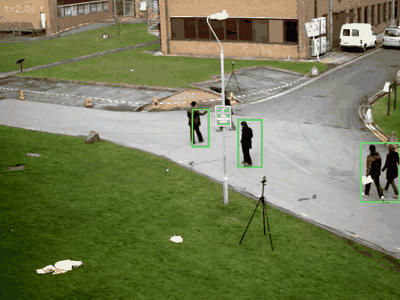
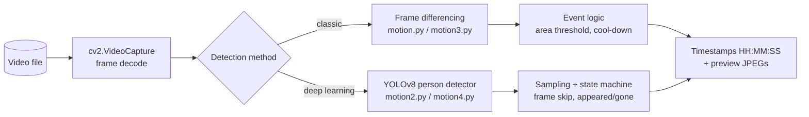
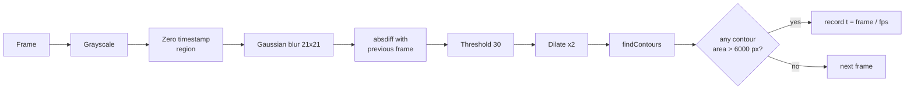
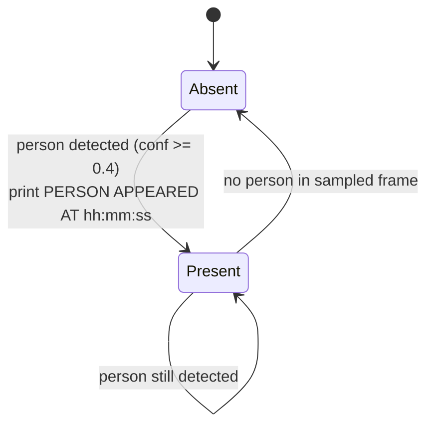
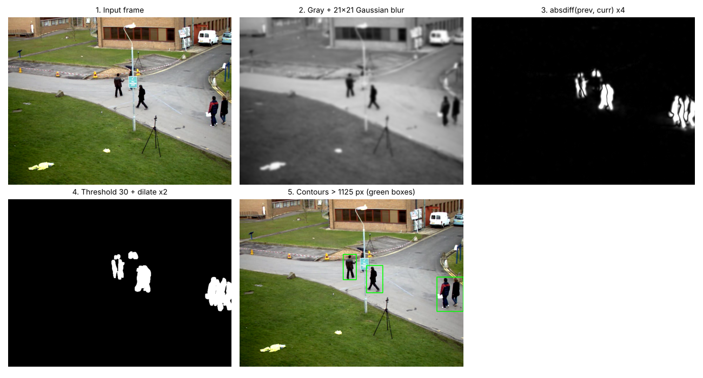
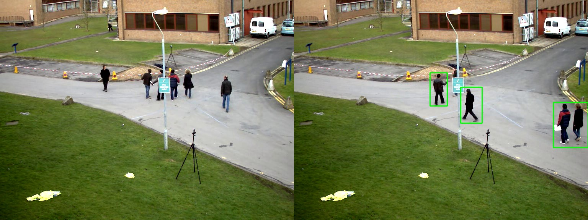
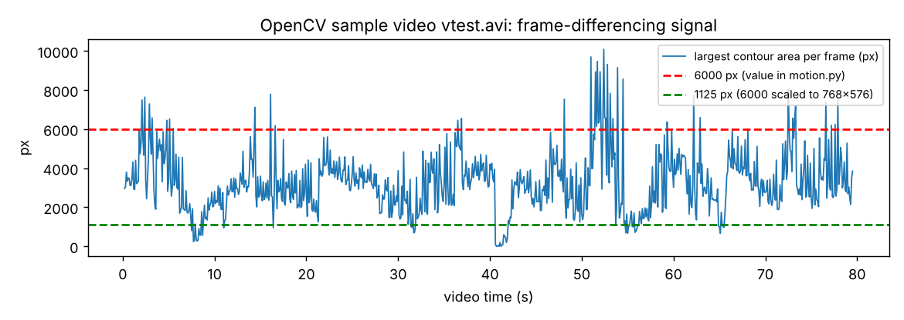

# Motion Detecting on Videos

My old CCTV camera doesn't have motion detection, and scrolling through hours of footage to find the one moment something happened gets old fast. So I wrote these four small OpenCV / YOLO scripts. They go through a long video and tell you *when something happens*: either any real motion (classic frame differencing) or a **person** showing up (YOLOv8 object detection). You get a list of timestamps, and optionally preview JPEGs, so you can jump straight there.



*The frame-differencing detector from `motion.py` running on a pedestrian video. Green boxes are contours above the area threshold. The clip is OpenCV's sample video `vtest.avi` (not included here), see [Demo footage](#demo-footage-and-measurements).*

## Table of contents
1. [Features](#features)
2. [Tech stack](#tech-stack)
3. [The four scripts](#the-four-scripts)
4. [Architecture and pipelines](#architecture-and-pipelines)
5. [How it works](#how-it-works)
6. [Tuning parameters](#tuning-parameters)
7. [Demo footage and measurements](#demo-footage-and-measurements)
8. [How to run](#how-to-run)
9. [Repo structure](#repo-structure)
10. [Limitations](#limitations)

## Features
- **Motion detection by frame differencing** with Gaussian blur, a binary threshold, dilation and a minimum contour area (`motion.py`).
- **Masks out the camera's on-screen clock** so the ticking time doesn't count as motion.
- **Groups events with a cool-down** (`EVENT_GAP`) and **saves a preview frame** to `previews/HH_MM_SS.jpg` (`motion3.py`).
- **Person detection with YOLOv8** (COCO class 0) on a sample of frames: one per second (`motion2.py`), or every 3rd frame with an *appeared / gone* state (`motion4(working).py`).
- Times are printed as `HH:MM:SS` so you can paste them right into a video player.

## Tech stack
- **Language:** Python 3
- **Libraries:** OpenCV (`cv2`) for decoding, filtering and contours; NumPy (comes with OpenCV); [Ultralytics](https://github.com/ultralytics/ultralytics) YOLOv8 (`yolov8n.pt`, `yolov8s.pt` pretrained COCO weights, PyTorch underneath)
- **Ideas used:** frame differencing, morphological dilation, contour area filtering, object detection, grouping detections into events over time

## The four scripts

| Script | Method | Output | Main settings |
|---|---|---|---|
| `motion.py` | Difference between consecutive frames; clock area blanked out (`gray[0:120, 1200:2047]`); 21x21 blur | List of motion times in seconds | diff threshold 30, dilate x2, contour area > 6000 px |
| `motion2.py` | YOLOv8n person detection on 1 frame per second | `HH:MM:SS` for every sampled second with a person in it; progress every 431 frames | conf 0.3, `classes=[0]`, `FRAME_STEP=int(fps)`, fps fallback 2.5 |
| `motion3.py` | Counts changed pixels (no contours) + cool-down; saves the frame that triggered it | `Motion: HH:MM:SS` lines + `previews/*.jpg` | 5x5 blur, diff threshold 25, > 1200 changed pixels, `EVENT_GAP` = 3 s |
| `motion4(working).py` | YOLOv8s person detection on every 3rd frame, tracks `person_active` | `PERSON APPEARED AT HH:MM:SS` once each time someone shows up | conf 0.4, `FRAME_SKIP=3` |

Every script has a placeholder video path (`D:/XXX/XXX.mp4`). Change it to your own file.

## Architecture and pipelines



The frame-differencing steps in `motion.py`:



How `motion4(working).py` decides someone appeared:



## How it works

**Frame differencing (`motion.py`, `motion3.py`).** Each frame goes to grayscale and gets blurred to smooth out sensor noise. Then I take the absolute difference from the previous frame and threshold it into a black-and-white mask. `motion.py` dilates that mask so nearby bits join up, finds the outer contours, and flags the frame if any contour is bigger than 6000 px. That size filter gets rid of small noise and leftover text. `motion3.py` is simpler: it just counts changed pixels (more than 1200 means motion), then ignores anything else for 3 s and saves the frame to `previews/`.



**YOLO person detection (`motion2.py`, `motion4(working).py`).** A pretrained YOLOv8 model looks at only some of the frames (1 per second, or every 3rd). Detection is a lot slower than differencing, so sampling is what makes hour-long videos doable. `motion4` keeps a `person_active` flag, so someone who stays in view gives you **one** "appeared" line instead of one per frame.


**Before / after.** Left: a frame with no motion flagged. Right: a frame where three people walking are above the area threshold.



## Tuning parameters

| Parameter | Where | What happens if you raise it |
|---|---|---|
| Blur kernel (21x21 / 5x5) | `motion.py` / `motion3.py` | Less noise, slower, small things get blurred away |
| Difference threshold (30 / 25) | all diff scripts | Fewer false alarms, but low-contrast movement gets missed |
| Dilation iterations (2) | `motion.py` | Small pieces merge into bigger contours |
| Contour area (6000 px) / changed pixels (1200) | `motion.py` / `motion3.py` | Smaller objects are ignored; **depends on the video resolution** |
| `EVENT_GAP` (3 s) | `motion3.py` | Fewer, longer events |
| Timestamp mask `[0:120, 1200:2047]` | `motion.py` | Has to match where the clock is in *your* video |
| YOLO model (`n` vs `s`) / `conf` | `motion2/4` | `s` is more accurate but about 2x slower on CPU; higher `conf` means fewer false detections |
| `FRAME_STEP` / `FRAME_SKIP` | `motion2/4` | Bigger is faster, but you might miss someone who's only there briefly |

You can see how much the area threshold matters in this plot. It shows the biggest contour per frame against the 6000 px value from the script, and against the same threshold scaled to this clip's resolution:



## Demo footage and measurements

My own CCTV videos aren't in the repo (the scripts point to `D:/XXX/XXX.mp4`). For the images above I ran the same logic on a public sample clip instead: OpenCV's `samples/data/vtest.avi`, people walking on a campus path (768x576, 10 fps, 795 frames, 79.5 s). The clip isn't included here. I measured these on a 4-core CPU with no GPU, using OpenCV 5.0 and Ultralytics 8.4 / PyTorch 2.15. They're numbers for this clip only, not for my own footage.

| Measurement (vtest.avi) | Result |
|---|---|
| `motion.py` speed (decode + processing) | about 440-480 frames/s (3 runs: 478.6, 452.0, 442.1 fps) |
| `motion.py` with the original 6000 px threshold | 42 of 794 frame pairs flagged (5 %), first one at 2.1 s |
| same logic with the threshold scaled to 768x576 (about 1125 px) | 748 of 794 flagged (94 %), since people are walking through almost the whole time |
| `motion3.py` as is | 26 events, 26 preview JPEGs (capped by the 3 s `EVENT_GAP`) |
| `motion2.py` (YOLOv8n, conf 0.3, 1 frame/s) | 80 sampled frames, a person in all 80; 7.7 s for the whole run including loading the model |
| `motion4(working).py` (YOLOv8s, conf 0.4, every 3rd frame) | 265 frames in about 31 s total; 1 "PERSON APPEARED" event (someone is already in view at t = 0) |
| YOLOv8n on CPU | about 48 ms/frame (about 21 fps) |
| YOLOv8s on CPU | about 99 ms/frame (about 10 fps) |

## How to run

```bash
git clone https://github.com/kookithub/Motion-Detecting-on-Videos.git
cd Motion-Detecting-on-Videos
pip install opencv-python ultralytics      # ultralytics also installs PyTorch
# set VIDEO / VIDEO_PATH at the top of the script you want, then:
python motion.py            # motion timestamps (seconds)
python motion3.py           # motion events + previews/*.jpg
python motion2.py           # person timestamps, 1 frame per second
python "motion4(working).py"  # person-appeared events
```

Ultralytics downloads the YOLO weights (`yolov8n.pt`, `yolov8s.pt`) the first time you run it. Remember to move the timestamp mask in `motion.py` to wherever the clock is in your video.

## Repo structure
```
.
├── motion.py              # contour-based motion timestamps (clock masked)
├── motion2.py             # YOLOv8n person detection, 1 frame / second
├── motion3.py             # pixel-count motion + cool-down + preview JPEGs
├── motion4(working).py    # YOLOv8s person appeared/gone detection
└── docs/images/           # figures and demo GIF
```

## Limitations
- Video paths and the clock mask are hard-coded. There's no command-line options or config file yet.
- Results only go to the console (apart from the preview images in `motion3.py`).
- The pixel and area thresholds were set for my camera's resolution (the mask assumes 2048-px-wide frames), so other videos need re-tuning. The 6000 px vs. scaled threshold results above show how big the difference can be.
- Comparing consecutive frames picks up *change per frame*, so something moving slowly in a high-fps video barely registers. Camera shake or a lighting change will trigger false events.
- The YOLO scripts only look at some frames, so a very quick appearance between samples can be missed. There's no tracking of who is who across frames, and without a GPU it's slow on long videos.
- No tests, and no checking against hand-labelled footage.
