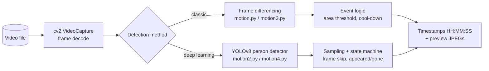
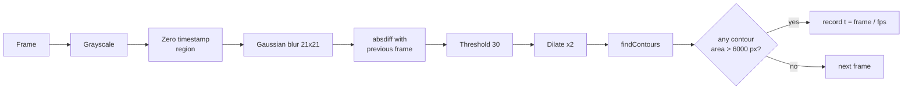
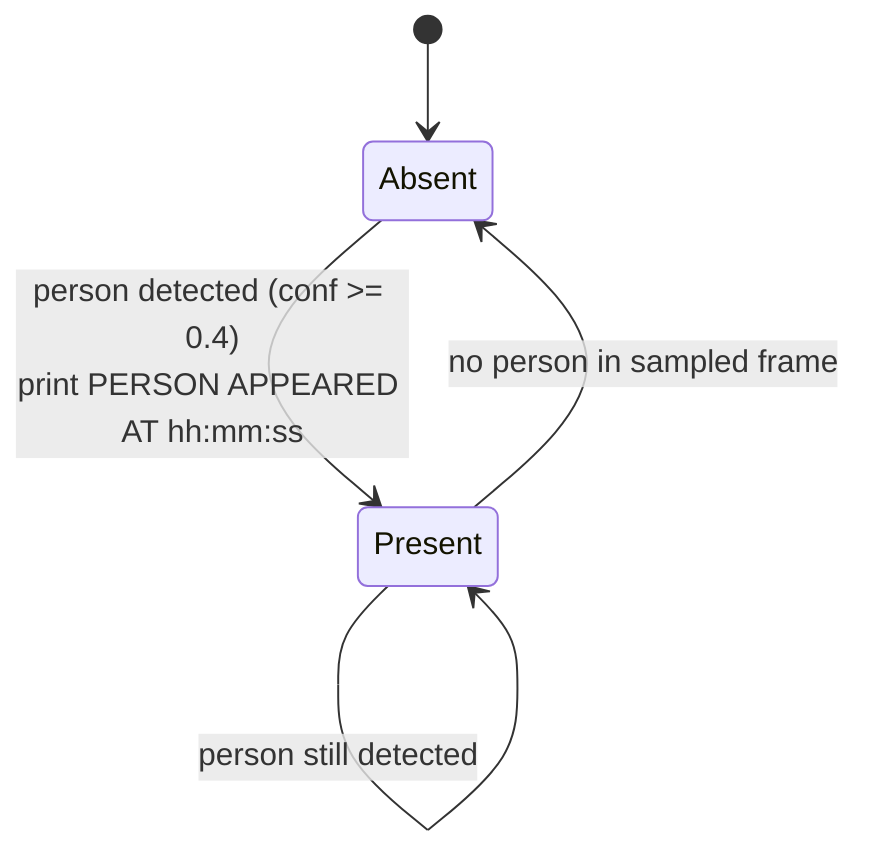
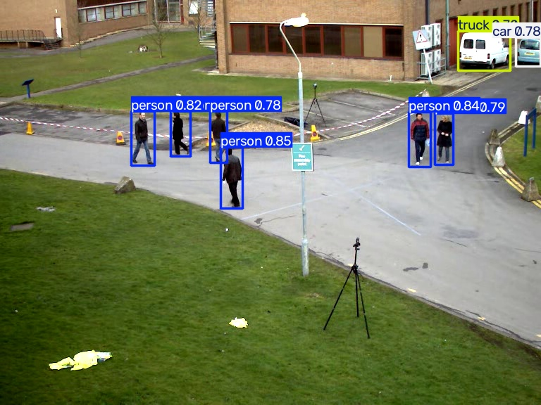

# Motion Detecting on Videos

Four small OpenCV / YOLO scripts that scan **long surveillance-style videos** and report *when something happens*: either any significant motion (classic frame differencing) or the appearance of a **person** (YOLOv8 object detection). Instead of watching hours of footage, you get a list of timestamps (and optionally preview JPEGs) to jump to.


*Frame-differencing detector (the logic of `motion.py`) running on a pedestrian video; green boxes are contours above the area threshold. Demo clip: OpenCV's sample video `vtest.avi` (not part of this repo) - see [Demo footage](#demo-footage--measurements).*

## Table of contents
1. [Features](#features)
2. [Tech stack](#tech-stack)
3. [The four scripts](#the-four-scripts)
4. [Architecture and pipelines](#architecture-and-pipelines)
5. [How it works](#how-it-works)
6. [Tuning parameters](#tuning-parameters)
7. [Demo footage and measurements](#demo-footage--measurements)
8. [How to run](#how-to-run)
9. [Repo structure](#repo-structure)
10. [Limitations](#limitations)
11. [Project Facts (for resume)](#project-facts-for-resume)

## Features
- **Frame-differencing motion detector** with Gaussian blur, binary threshold, dilation and contour-area filtering (`motion.py`).
- **Masking of a burned-in timestamp** region so the ticking clock is not counted as motion.
- **Event grouping with a cool-down** (`EVENT_GAP`) and **preview-frame export** to `previews/HH_MM_SS.jpg` (`motion3.py`).
- **Person detection with YOLOv8** (COCO class 0) on sampled frames: one frame per second (`motion2.py`), or every 3rd frame with an *appeared / gone* state machine (`motion4(working).py`).
- Timestamps printed as `HH:MM:SS` so they can be pasted into a video player.

## Tech stack
- **Language:** Python 3
- **Libraries:** OpenCV (`cv2`) for decoding, filtering, contours; NumPy (dependency of OpenCV); [Ultralytics](https://github.com/ultralytics/ultralytics) YOLOv8 (`yolov8n.pt`, `yolov8s.pt` pretrained COCO weights, PyTorch backend)
- **Concepts:** background/frame differencing, morphological dilation, connected-contour area filtering, object detection, temporal event segmentation

## The four scripts

| Script | Method | Output | Key settings |
|---|---|---|---|
| `motion.py` | Frame differencing between consecutive frames; timestamp area zeroed (`gray[0:120, 1200:2047]`); blur 21x21 | List of motion times in seconds | diff threshold 30, dilate x2, contour area > 6000 px |
| `motion2.py` | YOLOv8n person detection on 1 frame per second | `HH:MM:SS` of every sampled second that contains a person; progress counter every 431 frames | conf 0.3, `classes=[0]`, `FRAME_STEP=int(fps)`, fps fallback 2.5 |
| `motion3.py` | Pixel-count differencing (no contours) + event cool-down; saves the triggering frame | `Motion: HH:MM:SS` lines + `previews/*.jpg` | blur 5x5, diff threshold 25, > 1200 changed pixels, `EVENT_GAP` = 3 s |
| `motion4(working).py` | YOLOv8s person detection on every 3rd frame, tracks `person_active` | `PERSON APPEARED AT HH:MM:SS` once per appearance | conf 0.4, `FRAME_SKIP=3` |

The video path in every script is a placeholder (`D:/XXX/XXX.mp4`) - set it to your own file.

## Architecture and pipelines



Frame-differencing pipeline (`motion.py`):



Person-appearance logic (`motion4(working).py`):



## How it works

**Frame differencing (`motion.py`, `motion3.py`).** Each frame is converted to grayscale and blurred to suppress sensor noise. The absolute difference to the previous frame is thresholded to a binary mask; `motion.py` dilates it so nearby fragments merge, extracts external contours and flags the frame when any contour is larger than 6000 px (this filters small noise and leftover text). `motion3.py` skips contours and simply counts changed pixels (> 1200), then suppresses further events for 3 s and writes the frame to `previews/`.


**YOLO person detection (`motion2.py`, `motion4(working).py`).** A pretrained YOLOv8 model runs on a subset of frames (1 per second, or every 3rd) - detection is far more expensive than differencing, so sampling keeps hour-long videos tractable. `motion4` keeps a `person_active` flag so a person who stays in view produces **one** "appeared" line instead of one per frame.



**Before / after.** Left: a frame with no flagged motion; right: a frame where three pedestrians exceed the area threshold.


## Tuning parameters

| Parameter | Where | Effect of raising it |
|---|---|---|
| Blur kernel (21x21 / 5x5) | `motion.py` / `motion3.py` | Less noise, slower, small objects blur away |
| Difference threshold (30 / 25) | all diff scripts | Fewer false positives, misses low-contrast movers |
| Dilation iterations (2) | `motion.py` | Merges fragments into bigger contours |
| Contour area (6000 px) / changed pixels (1200) | `motion.py` / `motion3.py` | Ignores smaller objects; **depends on video resolution** |
| `EVENT_GAP` (3 s) | `motion3.py` | Fewer, coarser events |
| Timestamp mask `[0:120, 1200:2047]` | `motion.py` | Must match where the on-screen clock sits in *your* video |
| YOLO model (`n` vs `s`) / `conf` | `motion2/4` | `s` is more accurate but ~2x slower on CPU; higher `conf` = fewer false detections |
| `FRAME_STEP` / `FRAME_SKIP` | `motion2/4` | Larger = faster scan, may miss brief appearances |

The effect of the area threshold is visible in this signal plot (largest contour area per frame vs. the 6000 px value in the script and the same threshold scaled to this clip's resolution):


## Demo footage and measurements

The author's own videos are not in the repo (the scripts point to `D:/XXX/XXX.mp4`). To produce the figures above the **actual script logic was run on a public sample clip**: OpenCV's `samples/data/vtest.avi` (pedestrians on a campus path; 768x576, 10 fps, 795 frames = 79.5 s). The clip is not redistributed here. Numbers are from a 4-core CPU-only Linux container (no GPU) with OpenCV 5.0 and Ultralytics 8.4 / PyTorch 2.15, and are **my measurements for this clip, not figures from the original coursework footage**.

| Measurement (vtest.avi) | Result |
|---|---|
| `motion.py` logic throughput (decode + processing) | about 440-480 frames/s (3 runs: 478.6, 452.0, 442.1 fps) |
| `motion.py` with the original 6000 px threshold | 42 of 794 frame pairs flagged (5 %) - first at 2.1 s |
| same logic with the threshold scaled to 768x576 (about 1125 px) | 748 of 794 flagged (94 %) - the scene has near-continuous foot traffic |
| `motion3.py` (as written) | 26 events -> 26 preview JPEGs (limited by the 3 s `EVENT_GAP`) |
| `motion2.py` (YOLOv8n, conf 0.3, 1 frame/s) | 80 sampled frames, person in all 80; whole run 7.7 s including model load |
| `motion4(working).py` (YOLOv8s, conf 0.4, every 3rd frame) | 265 frames inferred in about 31 s total; 1 "PERSON APPEARED" event (a person is in view from t = 0) |
| YOLOv8n inference, CPU | about 48 ms/frame (about 21 fps) |
| YOLOv8s inference, CPU | about 99 ms/frame (about 10 fps) |

## How to run

```bash
git clone https://github.com/kookithub/Motion-Detecting-on-Videos.git
cd Motion-Detecting-on-Videos
pip install opencv-python ultralytics      # ultralytics pulls in PyTorch
# edit VIDEO / VIDEO_PATH at the top of the script you want, then:
python motion.py            # motion timestamps (seconds)
python motion3.py           # motion events + previews/*.jpg
python motion2.py           # person timestamps, 1 frame per second
python "motion4(working).py"  # person-appeared events
```

YOLO weights (`yolov8n.pt`, `yolov8s.pt`) are downloaded automatically by Ultralytics on first use. Adjust the timestamp mask in `motion.py` to your video's resolution/layout.

## Repo structure
```
.
├── motion.py              # contour-based motion timestamps (timestamp masked)
├── motion2.py             # YOLOv8n person detection, 1 frame / second
├── motion3.py             # pixel-count motion + cool-down + preview JPEGs
├── motion4(working).py    # YOLOv8s person appeared/gone detection
└── docs/images/           # figures and demo GIF
```

## Limitations
- Video paths and the timestamp mask are hard-coded; no command-line interface or config file.
- Results are printed to the console only (except `motion3.py` preview images).
- Pixel/area thresholds are tied to the original footage's resolution (the mask assumes 2048-px-wide frames); they must be re-tuned for other videos (see the 6000 px vs. scaled-threshold results above).
- Consecutive-frame differencing responds to *change per frame*, so slow-moving objects at high frame rates produce small differences; a camera shake or lighting change produces false events.
- YOLO scripts sample frames, so very short appearances between samples can be missed; no tracking or identity across frames; CPU inference is slow on long videos without a GPU.
- No tests or evaluation against ground-truth labels.

## Project Facts (for resume)

- **Course:** TODO: confirm (no course code or name in the repo name or code)
- **Solo or team:** TODO: confirm (git history has a single "Add files via upload" commit by the repo owner)
- **My contributions:** TODO: confirm (single upload commit, 2026-10-17, containing all four scripts)
- **Languages / frameworks / libraries:** Python 3; OpenCV (`cv2`); NumPy; Ultralytics YOLOv8 (PyTorch) with `yolov8n.pt` and `yolov8s.pt` pretrained weights
- **Size:** 4 Python scripts, 189 lines total (50 / 37 / 51 / 51); 0 classes; 0 tests
- **Key features:** frame-differencing motion detection with contour-area filtering; on-screen timestamp masking; event cool-down and preview-frame export; YOLOv8 person detection with frame sampling; person appeared/gone state tracking; `HH:MM:SS` timestamp output
- **Algorithms / design patterns:** absolute frame difference, Gaussian blur, binary threshold, morphological dilation, contour extraction and area filtering; pretrained CNN object detection (YOLOv8, COCO class 0 = person); frame sampling; two-state presence machine; time-based event debouncing
- **Measurable numbers (measured by me on the public OpenCV clip `vtest.avi`, 768x576, 10 fps, 795 frames, 4-core CPU):** frame-differencing about 440-480 frames/s; YOLOv8n about 48 ms/frame, YOLOv8s about 99 ms/frame on CPU; `motion3.py` produced 26 events; `motion.py` flagged 42/794 frames at the original 6000 px threshold. Parameters in the code: diff threshold 30 / 25, blur 21x21 / 5x5, contour area 6000 px, 1200 changed pixels, `EVENT_GAP` 3 s, YOLO conf 0.3 / 0.4, frame step 1 per second / every 3rd frame. Length, resolution, frame rate and event counts of the author's own footage: TODO: confirm
- **Hard problems and how they were solved (from the code):** the burned-in camera clock created constant false motion -> its region is zeroed before differencing; small noise and text produced false positives -> Gaussian blur, dilation and a 6000 px contour-area filter; bursts of consecutive detections -> 3 s event gap (`motion3.py`) and a `person_active` flag (`motion4`); slow full-video YOLO inference -> frame sampling (`FRAME_STEP` / `FRAME_SKIP`); TODO: confirm which of these the author considers the hardest
- **Outcome:** working scripts for locating motion and person appearances in long videos; TODO: confirm real-world use, grade or demo
